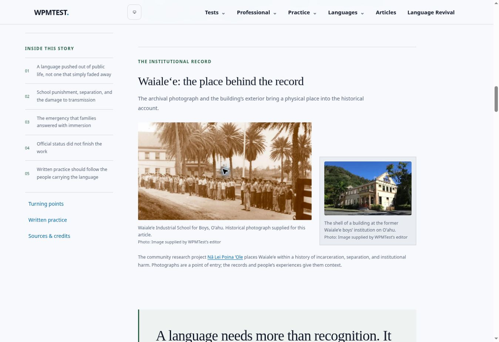

# Language revival editorial redesign

The previous articles used an almost uninterrupted text layout and interchangeable landscape openings. This change gives all eleven languages individual editorial headlines and introductions, new location photography, readable chapters, a desktop chapter rail, pull quotes, a chronological timeline, and clear onward links to written practice and source material.

The Hawaiian article incorporates all six supplied photographs in a contextual photo essay: two Waialeʻe views accompany the institutional history, the large education photograph follows the immersion chapter, and three images of children participating in cultural and land-based activities accompany the discussion of living use. The Waialeʻe opening date is supported by Nā Lei Poina ʻOle. No fatal-fire claim is included. The supplied photographs do not establish a named school, exact date, or the language spoken by their subjects; captions do not invent these details or original photographer credits.

The collection overview retains every paragraph of the approved “Living Languages. Lasting Connections.” passage, including its emphasis. Its directory now has photograph-led cards, expandable context, and separate history/practice links. Existing public paths and the Glossika integration are retained.

## Validation

- 28 Vitest files, 130 tests pass, including chapter-anchor, practice-link, attribution, and supplied-photo coverage.
- TypeScript and production static export pass.
- SEO export audit: 105 HTML outputs, 100 sitemap URLs, no duplicate titles/descriptions/canonicals, no unresolved internal links, and no image-sitemap errors. 108 page/image associations.
- Desktop Chromium visual review covered the Hawaiian article, photo essay, working sticky navigation, and overview. Narrow-layout visual review used browser zoom; actual iOS/Android keyboard and device testing was not performed.
- Location photographs have local WebP assets, smaller variants, alt text, and visible author/license credits. Panoramic images select sufficient source resolution for their cropped presentation.
- GitHub Actions remains subject to the previously reported account billing lock. Local checks are the validation evidence; a blocked Actions job must not be described as a test failure in the code or as passing CI.

## Review before merging

- Review the Hawaiian photographs and the overview on desktop and a phone.
- The image-by-image source and license record is in `src/features/revival/photoSources.json`; the supplied-image mapping is in `src/features/revival/hawaiianPhotos.json`.
- This branch does not delete remote branches. The earlier repository audit’s exact reviewed branch heads and dispositions remain in `docs/REPOSITORY-AUDIT-2026-11-10.md` for manual cleanup.
- No Amazon tracking ID or tagged product URL was supplied. Amazon configuration is still pending that account-specific information; no invented affiliate links are introduced.

## Preview

